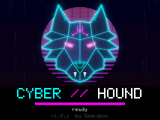
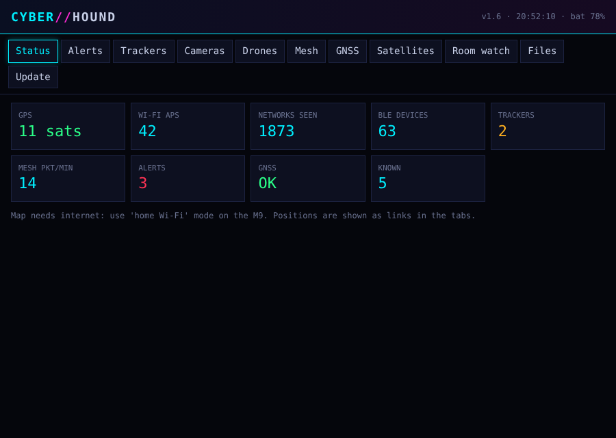

# Cyber Hound — User Manual

*Covers version 1.10.0 · for the Elecrow ThinkNode M9 · by Geekaboo*

## What Cyber Hound is



Cyber Hound is a **receive-only** RF awareness firmware for the Elecrow ThinkNode M9. It listens to Wi-Fi, Bluetooth LE, LoRa (868 MHz) and GNSS and tells you what is around you: suspicious Wi-Fi behaviour, Bluetooth trackers that follow you, cameras and doorbells, drones broadcasting Remote ID, LoRaWAN sensors, MeshCore and Meshtastic traffic, GNSS jamming or spoofing, and more. It never transmits attacks — the only things it sends are the optional web dashboard hotspot and WiGLE/satellite-data downloads over your own home Wi-Fi.

| Hardware used | What for |
|---|---|
| ESP32-S3 Wi-Fi + BLE | Wi-Fi monitor, BLE scanner, Remote ID, dashboard |
| LR1110 radio | LoRa 868 MHz: MeshCore, Meshtastic, LoRaWAN, spectrum |
| GNSS receiver | Position for logs, wardriving, jamming/spoofing guard, satellite passes |
| QMC6309 compass | Direction finding |
| QMI8658 motion sensor | Room watch (was the device moved?) |
| 2.4" screen + 37-key keyboard | User interface |
| microSD | Logs, WiGLE files, satellite data |

## Getting started

### Flashing

There are two firmware files:

- **CyberHound_M9_v1.10.0_full.bin** — the complete image (bootloader, partitions and app). Flash it at address **0x0** with the Espressif web flasher or esptool when Cyber Hound is the only firmware on the M9.
- **CyberHound_M9_v1.10.0_app.bin** — the app only. Use this with **Launcher** (2.10.0 or newer) for multi-boot next to wadamesh, or upload it through the web dashboard's update page.

Example with esptool:

```
esptool --chip esp32s3 write_flash 0x0 CyberHound_M9_v1.10.0_full.bin
```

The USB-C port is a CH340 serial bridge, so serial logs appear at 115200 baud on that port.

### First boot

1. The werewolf splash shows with a short howl (muted if sound is off).
2. On the very first boot the **button learning wizard** starts. It asks you to press each of the 11 buttons (Up, Down, Left, Right, OK, Back, Home, Menu, Chat, Map, Pos) once. Press the button it names; it moves on automatically. The bottom line shows the raw key code it sees, which helps if a key doesn't register.
3. You land on the main menu. Insert a microSD card (FAT32 or exFAT) before boot if you want logging.

Press **SPACE** to skip a button (it keeps its default code). If no key is pressed for 60 seconds, the defaults are used. You can rerun the wizard any time from **Settings → Buttons**.

### Compass calibration

Direction finding and the satellite pointer need a calibrated compass. Go to **Settings → Compass** and press **OK**:

1. **Step 1** — turn the M9 slowly in every direction (flat, on its side, upside down; a figure-eight works) until the bar is full and it says *good – press OK*.
2. **Step 2** — hold it flat, screen up, turn yourself about a quarter turn to the right (clockwise) and press OK. This teaches it left from right.

Calibration is saved and survives reboots. Repeat it if headings drift or after you put the M9 in a new case.

## Buttons and keys

These work on every screen (except while you're typing text):

| Button | What it does |
|---|---|
| **Up / Down** | Move through lists, scroll |
| **Left / Right** | Change values, switch tabs, move cursor |
| **OK** (or ENTER) | Open / select / start |
| **Back** (or DEL) | Go back one screen |
| **Home** | Main menu |
| **Menu** | Button help screen (press again to close) |
| **Chat** | Alerts list |
| **Map** | Mesh health |
| **Pos** | Wardrive / logger |
| **?** or **H** | Button help screen |

The help screen shows every button, its learned code and what it does, and the last key you pressed — handy for testing. Press **L** there to relearn the buttons.

### Main menu shortcuts

| Key | App | Key | App |
|---|---|---|---|
| 1 | Spectrum | 9 | Wardrive |
| 2 | Detector | 0 | Settings |
| 3 | Tracker hunt | R | Room watch |
| 4 | Cameras | G | GNSS guard |
| 5 | Room sweep | S | Satellites |
| 6 | Drones | W | Web dashboard |
| 7 | LoRaWAN | T | Meshtastic |
| 8 | Mesh health | Chat | Alerts |

The menu also shows a live summary on the right: Wi-Fi access points, BLE devices, trackers (TAGS), cameras, mesh packets per minute, open alerts and whether the SD logger is recording.

### Letter keys inside apps

The bottom line of each screen always lists its keys. The most common ones:

- **D** — find direction of the selected device
- **K** — mark as known (stop alerting about it)
- **M** — mute / unmute the Geiger-style beep
- **A** — show all BLE devices or only trackers
- **B** — make a tracker beep (in Tracker hunt)
- **S** — save, or silent/beep (room watch), or lock SF (LoRaWAN)
- **U** — update satellite orbits
- **P** — change Meshtastic preset
- **N** — "I'm facing north" (helps the compass)

## The apps

### 1 · Spectrum
A live waterfall/bar view of the 868 MHz band from the LR1110. Use it to see which LoRa channels are busy. **Left/Right** move the cursor, **Up/Down** change the range, **P** clears the peak markers. Packet decoding pauses while Spectrum is open.

### 2 · Detector
Watches Wi-Fi and Bluetooth for signs of trouble — passive only, nothing is transmitted:
- **Deauth / disassociation floods** (someone kicking devices off Wi-Fi)
- **Evil twin** (a network with the same name but a different, suspicious access point)
- **Karma / probe answering** (an access point that answers to any network name)
- **Beacon floods** (lots of fake network names at once)
- **BLE spam** (pop-up spam such as fake pairing requests)

Each hit raises an alert and is written to the events log.

### 3 · Tracker hunt
Lists Bluetooth trackers nearby (AirTag/Find My, Tile, Samsung SmartTag, Chipolo and others) and flags any that seem to **follow you** — seen again over time and distance while you move. Press **A** to switch between trackers only and all BLE devices. Select one and press **OK** to hunt it: a Geiger-style beep speeds up as you get closer; **D** starts direction finding, **M** mutes, **B** makes it beep (see *Make it beep*). **K** marks a device as known so it never alerts again.

### 4 · Cameras
Recognises Wi-Fi cameras and video doorbells (Ring, Arlo, Eufy, Nest, Reolink, TP-Link Tapo, Hikvision, Dahua, Wyze, Blink and more — almost 200 manufacturer IDs) from the Wi-Fi traffic around you. **LIVE** means it is sending lots of data right now (probably streaming). **OK** opens a locate screen with signal strength and **D** for direction; **K** marks it as known.

### 5 · Room sweep
For checking a room such as a hotel room or Airbnb. It ranks every Wi-Fi and BLE device by a suspicion score (signal strength, upload traffic, camera/tracker type, unknown) and colours it cold / warm / **HOT**. Walk around the room slowly; the beep follows the strongest suspect. **OK** finds direction, **K** marks known, **S** saves a report to the SD card, **M** mutes.

### 6 · Drones
Receives drone **Remote ID** (the EU/US electronic licence plate) over Wi-Fi beacons, Wi-Fi NAN and Bluetooth. The map shows the drone as a triangle and the pilot/take-off position as a square. **OK** shows details: serial number or operator ID, EU category and class, height, speed and distance. Everything is logged to the SD card.

### 7 · LoRaWAN
Listens to LoRaWAN sensor uplinks on the 8 EU868 channels, hopping through spreading factors 7–12. It shows device addresses and the network they belong to (The Things Network, Helium, and others where known), packet counts and signal strength. **Left/Right** switch tabs, **S** locks one spreading factor, **C** locks one channel. Contents are encrypted — only headers are shown.

### 8 · Mesh health
MeshCore traffic on the Dutch preset (869.618 MHz, SF7, BW 62.5 kHz). Shows packets per minute, adverts with node names, hops, signal strength and noise. **Left/Right** switch tabs. You can change the preset or manual radio settings in Settings.

### 9 · Wardrive
Logs every Wi-Fi network and BLE device with GPS position to the SD card in WiGLE format. **OK** starts or pauses. **W** or **Right** opens WiGLE upload (see below).

### R · Room watch
Arm it and leave the M9 in your room. The motion sensor learns a baseline for 60 seconds, then records if the device is moved or the radio picture changes (new devices appearing). **OK** arms; pressing OK again disarms and saves a report. **S** switches between silent and beeping.

### G · GNSS guard
Watches the GPS signal for **jamming** (signal strength suddenly drops while satellites disappear) and **spoofing** (impossible position or altitude jumps, all satellites at the same strength, clock jumps). Results go to the alerts list and the events log.

### S · Satellites
Predicts passes for the ISS, the Chinese space station, Hubble, NOAA 15/19 and Meteor-M2 3/4 from orbit data on the SD card. **OK** tracks a pass: an arrow tells you which way to turn and how high to look. **U** downloads fresh orbit data over your home Wi-Fi, **P** recalculates, **N** tells the compass you're facing north. Needs a GPS fix for time and position.

### T · Meshtastic
A passive Meshtastic watcher that listens on an EU868 preset (LongFast by default; MediumFast/Slow, ShortFast/Slow, LongModerate, Narrow and Lite also available — press **P** to cycle). It decodes everything sent on the default public channels:
- **Nodes** — short and long name, hardware, role, hops away, signal, battery, and distance/bearing when the node shares its position. **OK** opens a node with full details and a direction arrow.
- **Chat** — public text messages with sender, channel and signal. New messages beep.
- **Stats** — packet counts, airtime, and which channel hashes are around you.

Private channels and direct messages are counted but stay encrypted. The LR1110 is shared with MeshCore, so Settings → *LoRa listen* chooses which network runs in the background (MeshCore, Meshtastic, or alternate every 60 s); opening this app or Mesh health tunes to that network while it's on screen. Everything is logged to `/hound/mtastic_NNNN.csv`.

### W · Web dashboard
Shows everything on your phone or laptop. See *Web dashboard* below.

### Alerts (Chat button)
All alerts in one list, newest first, also logged to `/hound/events.csv`. Repeated alerts for the same thing are grouped.

### Signal Catch (mini-game)
A small Game & Watch–style game, the last entry in the menu. The Hound sits in one of three lanes and data packets fall from the top: catch the **cyan** packets (be in their lane when they reach the bottom) for a point each, and **dodge the red jammer bolts** (don't be in their lane). Miss a good packet or catch a jammer and you lose one of three lives; it speeds up as your score climbs. **Left/Right** move between lanes, **OK** starts or restarts, **DEL** leaves. The high score is saved to the SD card (`/hound/signalcatch.txt`) and shown as **HI** — without a card it still plays, but the score isn't kept.

### Deauth Dodge (mini-game)
The second Game & Watch–style game. You're a Wi-Fi client in one of three lanes and **deauth bolts** rain down — move **Left/Right** to stay out of a lane when a bolt lands. Getting hit costs one of three lives, and it speeds up the longer you last. Your score is how many **seconds you survive**; **OK** starts or restarts, **DEL** leaves. The best time is saved to the SD card (`/hound/deauthdodge.txt`).

### Sentry (home baseline)
Learns what's normal in a place, then warns you when something new moves in. Stand where you want to guard and press **L** to learn the baseline — every Wi-Fi access point, Bluetooth device and camera around you right now is remembered (saved to the device, so it survives reboots). Press **OK** to arm it. While armed, any device that is **not** in the baseline and **sticks around** (about 3 minutes for an ordinary device, under a minute for a camera or tracker) is flagged once as a new arrival, with an alert, so passers-by don't trip it. The screen lists what it caught (type, name, signal, how long ago). **X** clears the baseline. Good for a hotel room, an Airbnb, or your own home while you're away — a step up from Room watch, which only notices movement and raw new devices.


### Nearby (Wi-Fi probe watch)
Shows client devices — phones, laptops, watches — around you, picked up from the Wi-Fi **probe requests** they send out looking for networks (like a Fingbox's "digital fence"). The list shows each device's MAC, signal strength (so you get rough distance), how many probes it has sent, and any network name it asked for; the header counts how many are active. A **~** marks a **randomised (privacy) MAC**.

What to expect: it's good for "how many devices are around me / is a new one hanging about," but **modern phones randomise their MAC** in probes and mostly send broadcast (wildcard) probes, so you usually **can't identify whose phone it is** or read their saved-network list — and a connected phone barely probes at all. So treat it as presence and proximity, not identification.

Sentry uses this too: a device with a **stable** (non-randomised) MAC that isn't in your baseline and lingers is flagged as a new **PHONE/client**. Randomised MACs are deliberately ignored there, because they change every few minutes — including your own phone's — and would cause constant false alarms.

### Aircraft (ADS-B from your Pi)
Shows planes overhead on a radar centred on you, pulled from your own ADS-B receiver (readsb / dump1090 / PiAware) over your home Wi-Fi. The radar plots each aircraft by bearing and distance (rings at 5/10/25 km, range 25 km), coloured by altitude — amber below 10,000 ft, green mid, cyan at cruise — and the list shows callsign, flight level, distance and a climb/descent arrow. **OK** opens a plane's full details: hex, squawk (7500/7600/7700 and emergency flags turn it red), aircraft class, altitude and vertical rate, ground and indicated speed, heading, distance/bearing with a compass arrow, position and feed signal. **U** refreshes.

It needs the M9 on the **same network as the Pi** — point its home Wi-Fi (Wardrive → W, or `cyberhound.cfg`) at the network the Pi lives on, not an isolated IoT/guest SSID, or it won't reach the feed. Like the web dashboard, Wi-Fi/BLE sniffing pauses while this screen is open. The feed URL (default `http://192.168.1.53:8080/data/aircraft.json`, with PiAware/dump1090 paths tried automatically) and the home position used when there's no GPS fix live in `cyberhound.cfg`.

**Local or public feed.** Press **F** on the Aircraft screen to switch source — shown top-left as **LOCAL** or **PUBLIC**. *Local* uses your own ADS-B receiver on the LAN (lowest latency, limited to your antenna's coverage; the default). *Public* needs no receiver at all: it pulls aircraft around your GPS position (or the home position in `cyberhound.cfg`) from a free internet aggregator (airplanes.live), refreshing a little slower to stay within fair use. The choice is saved and lives in `cyberhound.cfg` as `air_feed=local` or `air_feed=public` — so a build you share works for someone with no Pi. The plane detail view also looks up the flight's **origin → destination** (and airline) by callsign over the internet; scheduled flights resolve, charter/GA show as unknown.

## Special features

### Direction finding
Press **D** on a tracker, camera or room-sweep suspect. Hold the M9 flat in front of your chest and **turn slowly in a full circle** (about 10–20 seconds). Your body blocks the signal from behind, so the Hound measures where the signal is strongest and draws an arrow towards the source, with a confidence figure. If coverage is too patchy it asks you to turn again. **R** starts a new circle, **C** jumps to compass calibration. Works best outdoors or in large rooms; walls and reflections make it a rough guide, not a laser pointer.

### Make it beep
In **Tracker hunt** (list or hunt screen) press **B** to make a tracker play its sound, so you can find it in a bag or car. It uses the anti-stalking sound commands trackers expose for non-owners: AirTag, Apple Find My accessories, Google Find My Device / DULT tags and Pebblebee. A tracker only accepts this when it is **away from its owner** — otherwise the screen says the tag refused, which is normal. SmartTag and Tile don't support it. BLE scanning pauses for the 10–20 seconds it stays connected; press **B** again to stop the sound.

### Known devices
Your own phone, watch, earbuds and AirTags should not set off alarms. Mark a device with **K** in Trackers, Cameras or Room sweep, or open **Settings → Known devices** and press **L** to learn everything around you right now (do this at home with your own gear switched on). **X** forgets the selected device. Up to 96 devices are kept.

### WiGLE upload
Open it from **Wardrive → W** (or Settings → WiGLE upload). Fill in:

| Field | What to enter |
|---|---|
| Home Wi-Fi | Your home network name |
| Wi-Fi password | Its password |
| API name | From wigle.net → Account, the *Encoded for use* pair (not your login) |
| API token | Second half of that pair |
| Auto upload at home | On = uploads waiting files automatically when your home Wi-Fi is in range |
| Upload now | Uploads all waiting files immediately |

Uploaded files move to `/hound/sent/`. The same home Wi-Fi is used to refresh satellite orbit data.

### Web dashboard



Open **W · Web dashboard**, choose a mode with **Left/Right** and press **OK**:

- **Own hotspot** — the M9 creates a Wi-Fi network called **CyberHound-XXXX**. Scan the first QR code with your phone to join, then the second to open the page (http://192.168.4.1). No internet, so map tiles don't load.
- **Home Wi-Fi** — the M9 joins your home network (set it up in WiGLE first) and shows its address. Maps work because your phone still has internet.

Log in with user **hound** and the **8-digit PIN** shown on the screen; a new PIN is made each time you start the dashboard. The dashboard shows status, alerts, trackers, cameras, drones, MeshCore, Meshtastic, GNSS, satellites and room watch, and lets you download log files from the SD card. A firmware update page is available when Cyber Hound is flashed on its own; under Launcher, update through Launcher instead.

While the dashboard runs, Wi-Fi and BLE sniffing pause so the connection stays stable. Press **OK** again or leave the screen to stop it.

## Settings reference

Open with **0** from the menu. **Up/Down** select, **Left/Right** change, **OK** opens items marked with ›. Changes are saved straight away.

| Setting | Options | Notes |
|---|---|---|
| Sound | on / muted | All beeps and the howl |
| SD logging | on / off | Writes logs to `/hound/` on the card |
| WiGLE upload › | — | Home Wi-Fi and WiGLE API details |
| Known devices › | — | List, learn all (**L**), forget (**X**) |
| Compass › | — | Calibration wizard |
| MeshCore preset | NL (SF7), EU/UK narrow, EU/UK medium, EU/UK wide, US narrow, US wide | Default **NL (SF7)**: 869.618 MHz, BW 62.5 kHz, SF7, CR 4/5 |
| &nbsp;&nbsp;spreading | SF5–SF12 | Manual change shows preset as *custom* |
| &nbsp;&nbsp;bandwidth | 62.5 / 125 / 250 / 500 kHz | |
| &nbsp;&nbsp;coding rate | 4/5–4/8 | |
| &nbsp;&nbsp;frequency | MHz | **Left/Right** = 25 kHz steps, **< >** = 1 kHz |
| LoRa listen | MeshCore / Meshtastic / alternate | Which mesh the radio listens to in the background. Alternate swaps every 60 s. Opening Mesh health or Meshtastic overrides it while on screen. |
| Meshtastic preset | LongFast, MediumFast/Slow, ShortFast/Slow, LongMod, Narrow, Lite | EU868 preset for the Meshtastic watcher. LongFast is the default public one. Also on the Meshtastic screen with P. |
| Deauth alarm | 5–500 frames per 10 s | Lower = more sensitive |
| BLE spam alarm | 4–60 senders per 10 s | Lower = more sensitive |
| Screen | normal / flipped | Rotates the display 180° |
| Screen off | never, 15, 30, 60, 120, 300 s | Any key wakes the screen; that key press is not used as a command. Scanning continues with the screen off |
| Buttons | OK to relearn | Starts the button wizard |
| Restart / switch firmware | OK | Restarts the M9; with Launcher installed you can then pick another firmware such as wadamesh |

## Files on the SD card

Everything goes in the `/hound/` folder. Numbered files (`_0001`, `_0002`, …) start fresh on every boot so old logs are never overwritten.

| File | Contents |
|---|---|
| `wigle_NNNN.csv` | Wardrive log in WiGLE format: Wi-Fi and BLE with GPS position |
| `mesh_NNNN.csv` | MeshCore packets and adverts with signal strength |
| `mtastic_NNNN.csv` | Meshtastic nodes, positions, chat and telemetry heard |
| `cams_NNNN.csv` | Cameras and doorbells seen, with position |
| `drones_NNNN.csv` | Remote ID drones: ID, positions, pilot location |
| `sweep_*.txt` | Room sweep reports (saved with **S**) |
| `roomwatch_*.txt` | Room watch reports (saved when you disarm) |
| `events.csv` | Every alert with time, type and position |
| `tle.txt` | Satellite orbit data (refreshed with **U** or automatically at home) |
| `sent/` | WiGLE files that were uploaded successfully |
| `signalcatch.txt` | Signal Catch high score |
| `deauthdodge.txt` | Deauth Dodge best survival time |
| `cyberhound.cfg` | Wi-Fi + WiGLE settings, restored on the first boot after a flash |

The SD card sits inside the M9. The easiest way to get files off without opening the case is the **web dashboard**: its Files tab lets you download any log. The card can be FAT32 or exFAT.

## Config file (keep settings across a flash)

Flashing the full image wipes the M9's saved settings, so your home Wi-Fi and WiGLE details would normally have to be typed in again. To avoid that, Cyber Hound keeps a plain-text config on the SD card at `/hound/cyberhound.cfg` and reads it **once, on the first boot after a flash** to restore those settings.

It works two ways:
- **Automatic** — once you enter the Wi-Fi/WiGLE details on the M9, the file is written and kept in step. After the next reflash the first boot restores them.
- **By hand** — create the file yourself and drop it on the SD card before first boot, so you never type them on the device.

Format (values run to the end of the line; lines starting with `#` are ignored):

```
wifi_ssid=YourHomeNetwork
wifi_pass=YourWifiPassword
wigle_name=YourWigleApiName
wigle_token=YourWigleApiToken
wigle_auto=1
air_url=http://192.168.1.53:8080/data/aircraft.json
home_lat=52.08000
home_lon=4.31000
air_feed=local
```

`wigle_auto` is 1 for auto-upload at home, 0 for manual. `air_feed` is `local` (your own Pi) or `public` (internet aggregator, no receiver needed); `air_url` is the Pi feed and `home_lat`/`home_lon` the Aircraft fallback position. The file holds your Wi-Fi password and WiGLE token in clear text, so treat the SD card accordingly. It's only re-read after a flash — changes you make on the device afterwards win and are written back to the file.

## Troubleshooting

| Problem | Try this |
|---|---|
| Buttons do nothing or do the wrong thing | **Settings → Buttons** to relearn. On the help screen (**?** or **Menu**) the last raw key code is shown — if it stays empty, the keyboard isn't talking. ENTER and DEL always work as OK and Back. |
| Screen upside down | **Settings → Screen → flipped** |
| "No SD card" | Reseat the card, use FAT32 or exFAT, reboot. The error text on screen says what failed. |
| No MeshCore packets | Check the preset matches your mesh (NL = SF7, 869.618 MHz, BW 62.5). Send an advert from a radio nearby and watch Mesh health. |
| No Meshtastic nodes | Check the preset (LongFast is the usual default) with **P**, and make sure *LoRa listen* isn't stuck on MeshCore. Nodes only decode on the default public channels. |
| Can't join home Wi-Fi | Fixed in 1.7.1. If it still fails, check the credentials in WiGLE and grab the serial log at 115200 baud during the connect for the Wi-Fi status code. |
| No GPS position | Go outside with a clear sky; first fix can take a few minutes. Satellites and wardriving need a fix. |
| GNSS guard alarms indoors | Normal: signals fade indoors. Trust it outdoors only. |
| Direction arrow jumps around | Recalibrate the compass, keep the M9 flat, turn slower and do a full circle. Move away from metal. |
| Phone can't join the hotspot | Scan the QR code instead of typing; forget old *CyberHound* networks on your phone; stop and start the dashboard again. |
| Make it beep says the tag refused | Normal when the tracker is near its owner — it only rings when separated. SmartTag and Tile don't support it at all. |
| Screen turned off | Any key wakes it (that press is only a wake-up). New alerts also wake it. It stays on during hunt, direction finding, sweep and calibration. |

## Limits

- **Classic Bluetooth** (older headsets, some car kits) is invisible — the ESP32-S3 only does Bluetooth LE.
- **Wi-Fi is 2.4 GHz only**; cameras on 5 GHz won't be seen.
- **One LoRa channel at a time**: Mesh health listens to one frequency; LoRaWAN hops, so it can miss short packets.
- **One mesh at a time**: the radio listens to either MeshCore or Meshtastic, not both at once. On *alternate* it swaps every 60 s, so each is heard about half the time. LoRaWAN and Spectrum take the radio over completely while open.
- **Make it beep** only works on trackers that are separated from their owner, and not at all on SmartTag or Tile.
- **Camera detection** is based on manufacturer IDs and traffic. Cameras that are wired, use cellular, or only record locally (SD card, no Wi-Fi) can't be seen.
- **Trackers** that rotate their address may look like several devices; follow detection needs you to move around for a while.
- **Drones** are only seen if they broadcast Remote ID (required for most new drones in the EU, but not all).
- Direction finding is an estimate, best within a room or open space.

## Responsible use

Cyber Hound only listens; it never jams, deauths or attacks. Use it to protect yourself — find a tracker on your bag, check a rental for hidden cameras, or understand the radio world around you. Data you receive (especially Wi-Fi and Bluetooth identifiers) can be personal data, so keep logs to yourself and only upload to WiGLE what you're comfortable sharing.
